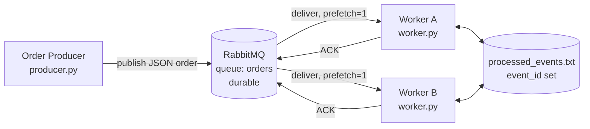

# Module 5 Assignment

A small asynchronous messaging system in Python using RabbitMQ:

- **Order Producer** (`producer.py`) publishes order messages (`event_id`, `order_id`, `item_id`, `quantity`) to the durable queue `orders`.
- **Order Worker** (`worker.py`) consumes orders, logs and processes them, records the `event_id`, and sends a manual ACK.

The producer and each worker run as independent processes.


## Architecture




Key settings:

| Setting | Why |
|---|---|
| `auto_ack=False` | The worker ACKs only after processing finishes. |
| `basic_qos(prefetch_count=1)` | Each worker holds one unacked message at a time, so work is shared fairly. |
| `durable=True` queue + persistent messages | Messages survive a broker restart. |
| `processed_events.txt` | Shared set of processed `event_id`s, so a duplicate is caught by *any* worker. |

## How to run

### 1. Prerequisites
- Docker (for RabbitMQ)
- Python 3.9+

### 2. Start RabbitMQ
```bash
docker compose up -d
```
Management UI: http://localhost:15672 (user `guest`, password `guest`).

### 3. Install dependencies
```bash
python -m venv .venv
source .venv/bin/activate        # Windows: .venv\Scripts\activate
pip install -r requirements.txt
```

### 4. Start two workers (two separate terminals)
```bash
# Terminal 1
python worker.py --name worker-A --reset
# Terminal 2
python worker.py --name worker-B
```

### 5. Publish orders (third terminal)
```bash
python producer.py --count 6
```

### Worker / producer options
| Command | Effect |
|---|---|
| `python producer.py --count N --start S` | Publish N orders `ORD-S` … |
| `python producer.py --duplicate` | Also re-publish the first order with the **same** `event_id` |
| `python worker.py --crash-on ORD-1003` | Worker exits **before processing and before ACK** when it gets ORD-1003 |
| `python worker.py --crash-on ORD-1003 --crash-point after-process` | Worker processes ORD-1003, records it, then exits **before ACK** |
| `python worker.py --crash-on-nth 2` | Worker crashes on the **2nd** new message *it* receives, whichever order that is (recommended for demos) |
| `python worker.py --reset` | Clear `processed_events.txt` on start |
| `python worker.py --work-seconds 2` | Simulated processing time |

Stop everything: `Ctrl+C` in worker terminals, then `docker compose down`.

---

## Evidence


### 1. Successful message processing + 2. Competing consumers

Run worker-A and worker-B, then `python producer.py --count 6`.

**Producer**
```
10:30:01 [producer] INFO    PUBLISHED {"event_id": "3f1c...a9", "order_id": "ORD-1001", "item_id": "ITEM-412", "quantity": 2}
10:30:01 [producer] INFO    PUBLISHED {"event_id": "8b27...10", "order_id": "ORD-1002", "item_id": "ITEM-735", "quantity": 1}
10:30:01 [producer] INFO    PUBLISHED {"event_id": "c0d4...5e", "order_id": "ORD-1003", "item_id": "ITEM-208", "quantity": 4}
10:30:01 [producer] INFO    PUBLISHED {"event_id": "19ae...77", "order_id": "ORD-1004", "item_id": "ITEM-561", "quantity": 3}
10:30:01 [producer] INFO    PUBLISHED {"event_id": "a6f0...2b", "order_id": "ORD-1005", "item_id": "ITEM-149", "quantity": 5}
10:30:01 [producer] INFO    PUBLISHED {"event_id": "e93b...c4", "order_id": "ORD-1006", "item_id": "ITEM-880", "quantity": 1}
10:30:01 [producer] INFO    Done. 6 message(s) sent to queue 'orders'.
```

**worker-A**
```
10:30:01 [worker-A] INFO    RECEIVED order_id=ORD-1001 event_id=3f1c...a9 redelivered=False delivery_tag=1
10:30:01 [worker-A] INFO    PROCESSING order_id=ORD-1001 item_id=ITEM-412 quantity=2
10:30:03 [worker-A] INFO    DONE order_id=ORD-1001 (event_id recorded)
10:30:03 [worker-A] INFO    ACK sent for order_id=ORD-1001
10:30:03 [worker-A] INFO    RECEIVED order_id=ORD-1003 event_id=c0d4...5e redelivered=False delivery_tag=2
...
10:30:05 [worker-A] INFO    ACK sent for order_id=ORD-1003
10:30:05 [worker-A] INFO    RECEIVED order_id=ORD-1005 ...
10:30:07 [worker-A] INFO    ACK sent for order_id=ORD-1005
```

**worker-B**
```
10:30:01 [worker-B] INFO    RECEIVED order_id=ORD-1002 event_id=8b27...10 redelivered=False delivery_tag=1
10:30:01 [worker-B] INFO    PROCESSING order_id=ORD-1002 item_id=ITEM-735 quantity=1
10:30:03 [worker-B] INFO    ACK sent for order_id=ORD-1002
10:30:03 [worker-B] INFO    RECEIVED order_id=ORD-1004 ...
10:30:05 [worker-B] INFO    ACK sent for order_id=ORD-1004
10:30:05 [worker-B] INFO    RECEIVED order_id=ORD-1006 ...
10:30:07 [worker-B] INFO    ACK sent for order_id=ORD-1006
```

**Result:** worker-A handled ORD-1001/1003/1005 and worker-B handled ORD-1002/1004/1006. Every order appears in exactly one worker's log, so the two workers are competing consumers on the same queue. (Screenshot idea: RabbitMQ UI → Queues → `orders` showing **Consumers: 2**.)

### 3. Failure and redelivery

> RabbitMQ hands messages to the two workers in turn, so a fixed `--crash-on ORD-xxxx`
> only fires if that order happens to go to worker-A. `--crash-on-nth 2` always fires
> on worker-A's second message.

```bash
# Terminal 1 – will crash on the 2nd message it receives, before processing / before ACK
python worker.py --name worker-A --crash-on-nth 2 --reset
# Terminal 2
python worker.py --name worker-B
# Terminal 3
python producer.py --count 6
```

**worker-A**
```
10:35:12 [worker-A] INFO    RECEIVED order_id=ORD-1001 event_id=51aa...0d redelivered=False delivery_tag=1
10:35:14 [worker-A] INFO    ACK sent for order_id=ORD-1001
10:35:14 [worker-A] INFO    RECEIVED order_id=ORD-1003 event_id=7d42...e8 redelivered=False delivery_tag=2
10:35:14 [worker-A] ERROR   SIMULATED CRASH before processing ORD-1003 - exiting WITHOUT sending ACK
```

**worker-B**
```
10:35:14 [worker-B] INFO    ACK sent for order_id=ORD-1002
10:35:14 [worker-B] INFO    RECEIVED order_id=ORD-1003 event_id=7d42...e8 redelivered=True delivery_tag=2
10:35:14 [worker-B] INFO    PROCESSING order_id=ORD-1003 item_id=ITEM-317 quantity=2
10:35:16 [worker-B] INFO    DONE order_id=ORD-1003 (event_id recorded)
10:35:16 [worker-B] INFO    ACK sent for order_id=ORD-1003
10:35:16 [worker-B] INFO    RECEIVED order_id=ORD-1004 ...
...
```

**Result:** worker-A received ORD-1003 but exited without ACK. RabbitMQ saw the connection close, put the unacked message back on the queue, and delivered it to worker-B with `redelivered=True`. worker-B processed the remaining orders, so the system kept running. worker-A can be restarted (`python worker.py --name worker-A`) and rejoins as a consumer.

### 4. Duplicate handling

**4a. Duplicate published by the producer**
```bash
python worker.py --name worker-A --reset     # Terminal 1
python worker.py --name worker-B             # Terminal 2
python producer.py --count 3 --duplicate     # Terminal 3
```

```
10:40:02 [producer] INFO    Re-publishing first order as a DUPLICATE (same event_id=0b9e...41)
...
10:40:04 [worker-B] INFO    RECEIVED order_id=ORD-1001 event_id=0b9e...41 redelivered=False delivery_tag=2
10:40:04 [worker-B] WARNING DUPLICATE detected event_id=0b9e...41 order_id=ORD-1001 - business action skipped
10:40:04 [worker-B] INFO    ACK sent for duplicate order_id=ORD-1001
```

**4b. Redelivery after the work was already done (crash after processing, before ACK)**
```bash
python worker.py --name worker-A --crash-on-nth 2 --crash-point after-process --reset
python worker.py --name worker-B
python producer.py --count 4
```

```
[worker-A] INFO    RECEIVED order_id=ORD-1003 event_id=4c11...9a redelivered=False delivery_tag=2
[worker-A] INFO    PROCESSING order_id=ORD-1003 item_id=ITEM-604 quantity=3
[worker-A] INFO    DONE order_id=ORD-1003 (event_id recorded)
[worker-A] ERROR   SIMULATED CRASH after processing ORD-1003 - exiting WITHOUT sending ACK

[worker-B] INFO    RECEIVED order_id=ORD-1003 event_id=4c11...9a redelivered=True delivery_tag=3
[worker-B] WARNING DUPLICATE detected event_id=4c11...9a order_id=ORD-1003 - business action skipped
[worker-B] INFO    ACK sent for duplicate order_id=ORD-1003
```

**Result:** in both cases the second copy of the event is recognized by its `event_id`, the business action is not repeated, and the message is ACKed so it leaves the queue. `processed_events.txt` contains each `event_id` exactly once.

---

## Reflection

**Why can a message be delivered more than once, and how does idempotent handling help?**

RabbitMQ gives at-least-once delivery: a message is only removed after the broker receives an ACK, so if a worker crashes, loses its connection, or times out after receiving a message but before its ACK arrives, the broker cannot know whether the work was done and redelivers the message to another consumer. Duplicates can also come from the producer side, for example when a publish is retried because a confirm was lost. Because the worker may have already completed the business action before failing, redelivery can cause the same order to be processed twice. Idempotent handling solves this by tagging every event with a unique `event_id` and recording which ones have been processed, so a repeated delivery is detected and skipped while still being ACKed. This makes "processing a message twice" have the same effect as processing it once, which lets us keep the reliability of redelivery without double-charging or double-shipping an order.